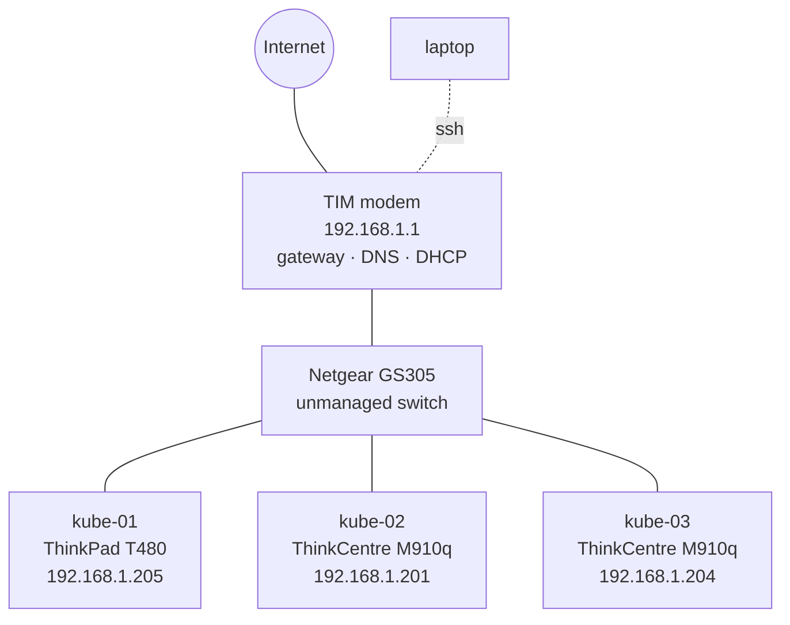
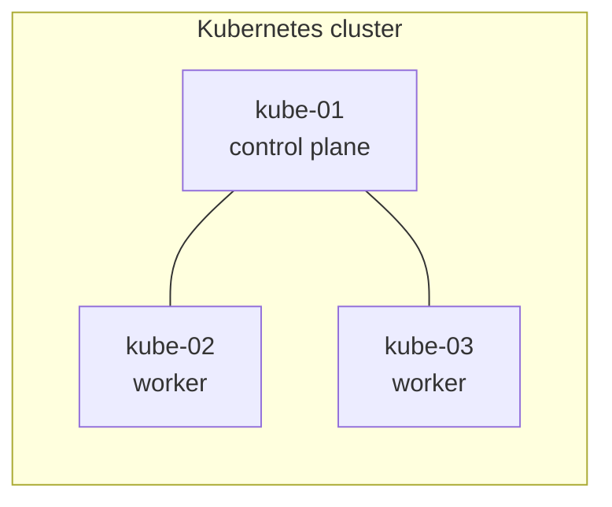

# Personal Homelab

My homelab. I use it to practice for certifications, try new stacks and self-host a few services.

```
.
├── README.md
└── labs/
    ├── cks/
    └── rhcsa/
```

## Topology

### Home network



- Network `192.168.1.0/24`, gateway and DNS `192.168.1.1`.
- The modem hands out DHCP addresses from `.2` upwards; the nodes use static addresses from `.201`.
- Nodes are wired to the switch; the switch has no IP.

### Nodes

| Host | Hardware | CPU threads | RAM | IP | Role |
|------|----------|-------------|-----|----|------|
| kube-01 | ThinkPad T480 | 8 | 16 GB | 192.168.1.205 | control plane |
| kube-02 | ThinkCentre M910q | 4 | 16 GB | 192.168.1.201 | worker |
| kube-03 | ThinkCentre M910q | 4 | 16 GB | 192.168.1.204 | worker |

All three run Debian 13 with a static address in `/etc/network/interfaces`. kube-01 has the lid switch set to `ignore` so it does not suspend when closed.

### Kubernetes cluster



### Address plan

| Range | Used by |
|-------|---------|
| 192.168.1.0/24 | Home LAN |
| 192.168.1.2 – .200 | DHCP (modem) |
| 192.168.1.201 – .254 | Static: nodes |
| 10.42.0.0/16 · 10.43.0.0/16 | Pods · services of the home cluster |

## Index

- [CKS lab](labs/cks/README.md)
- [RHCSA lab](labs/rhcsa/README.md)
