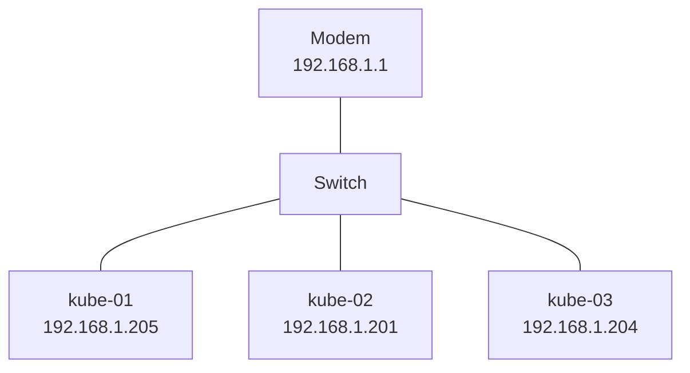

# Personal Homelab

Homelab for certification practice and self-hosting.

## Topology

| Host | Hardware | CPU | RAM | Role |
|------|----------|-----|-----|------|
| kube-01 | ThinkPad T480 | 8 threads | 16 GB | control plane |
| kube-02 | ThinkCentre M910q | 4 threads | 16 GB | worker |
| kube-03 | ThinkCentre M910q | 4 threads | 16 GB | worker |

All nodes run Debian 13 with static IPs on `192.168.1.0/24`.

## Index

- [CKS lab](labs/cks/README.md)
- [RHCSA lab](labs/rhcsa/README.md)
