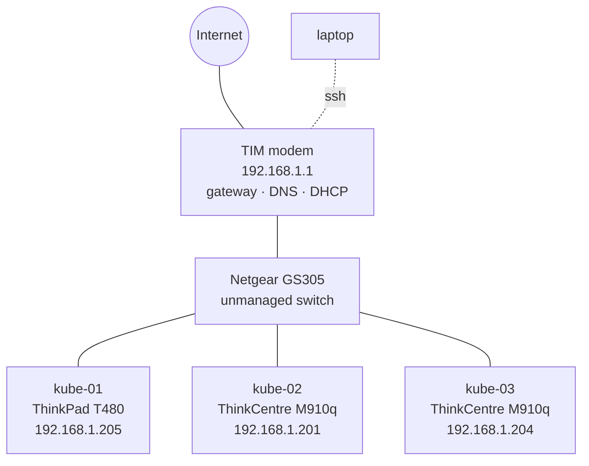
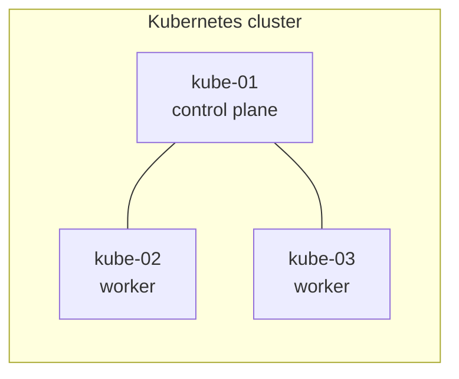
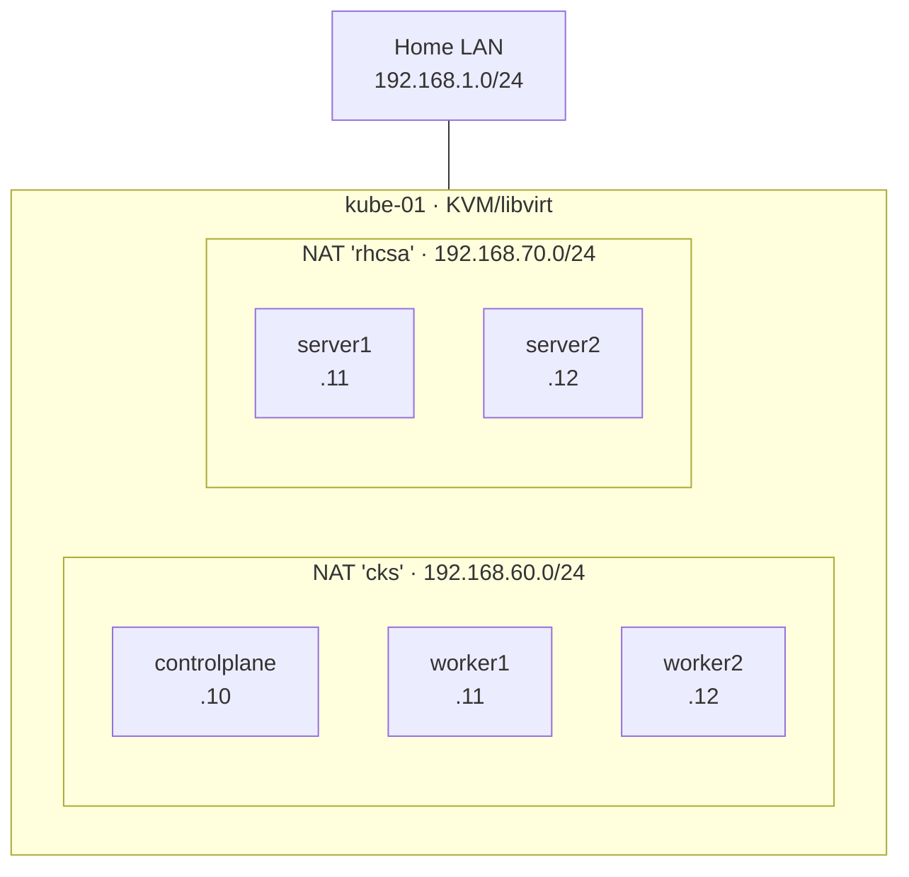

# personal_homelab

My homelab. I use it to practice for certifications, try new stacks and self-host a few services.

```
.
├── README.md
└── labs/
    ├── cks/      # kubeadm cluster for CKS practice
    └── rhcsa/    # Rocky Linux VMs for RHCSA practice
```

## Topology

### Home network



- Network `192.168.1.0/24`, gateway and DNS `192.168.1.1`.
- The modem hands out DHCP addresses from `.2` upwards; the nodes use static addresses from `.201`.
- Nodes are wired to the switch; the switch has no IP.

### Nodes

| Host | Hardware | CPU threads | RAM | IP | Role |
|------|----------|-------------|-----|----|------|
| kube-01 | ThinkPad T480 | 8 | 16 GB | 192.168.1.205 | control plane, libvirt host for the labs |
| kube-02 | ThinkCentre M910q | 4 | 16 GB | 192.168.1.201 | worker |
| kube-03 | ThinkCentre M910q | 4 | 16 GB | 192.168.1.204 | worker |

All three run Debian 13 with a static address in `/etc/network/interfaces`. kube-01 has the lid switch set to `ignore` so it does not suspend when closed.

### Kubernetes cluster



### Labs on kube-01

The labs run as KVM VMs on kube-01, each on its own libvirt NAT network. They can reach the internet but not the home LAN, and the LAN cannot reach them: connect from kube-01.



### Address plan

| Range | Used by |
|-------|---------|
| 192.168.1.0/24 | Home LAN |
| 192.168.1.2 – .200 | DHCP (modem) |
| 192.168.1.201 – .254 | Static: nodes |
| 10.42.0.0/16 · 10.43.0.0/16 | Pods · services of the home cluster |
| 192.168.60.0/24 | CKS lab VMs |
| 192.168.70.0/24 | RHCSA lab VMs |
| 10.244.0.0/16 · 10.96.0.0/12 | Pods · services inside the CKS lab |

## Labs

Each lab is a Terraform project that creates VMs on kube-01 through the `dmacvicar/libvirt` provider (pinned to 0.8.3).

| Dir | For | VMs |
|-----|-----|-----|
| `labs/cks/` | CKS | controlplane, worker1, worker2 (Ubuntu 24.04, kubeadm, Cilium) |
| `labs/rhcsa/` | RHCSA | server1, server2 (Rocky Linux 9, extra empty disks) |

`cks` builds the cluster on its own by default. Set `auto_bootstrap=false` to get prepared nodes and run `kubeadm init/join` yourself.

`rhcsa` does almost nothing on purpose: a user, an SSH key and a root password. The rest is the exercise.

### Host requirements

- KVM/QEMU and libvirt, with your user in the `libvirt` and `kvm` groups
- `genisoimage` (the provider uses it to build the cloud-init ISO)
- Terraform >= 1.5
- A libvirt storage pool called `default`
- `~/.ssh/id_ed25519.pub`
- Cloud images in `~/images`:
  - [noble-server-cloudimg-amd64.img](https://cloud-images.ubuntu.com/noble/current/noble-server-cloudimg-amd64.img)
  - [Rocky-9-GenericCloud-Base.latest.x86_64.qcow2](https://dl.rockylinux.org/pub/rocky/9/images/x86_64/Rocky-9-GenericCloud-Base.latest.x86_64.qcow2)

### Usage

```bash
cd labs/cks                     # or labs/rhcsa
terraform init
terraform apply
terraform output -raw connect   # SSH, console and VNC instructions
terraform destroy               # free the RAM when done
```

### Notes

- `terraform.tfstate` is not committed: it holds the kubeadm token and other secrets.
- Default passwords (`student` for the CKS console, `redhat` for RHCSA root) are lab-only. Override them in a `terraform.tfvars`, which is gitignored.
- Recreating the VMs changes their SSH host keys. Clear the old ones with `ssh-keygen -R <ip>`.
